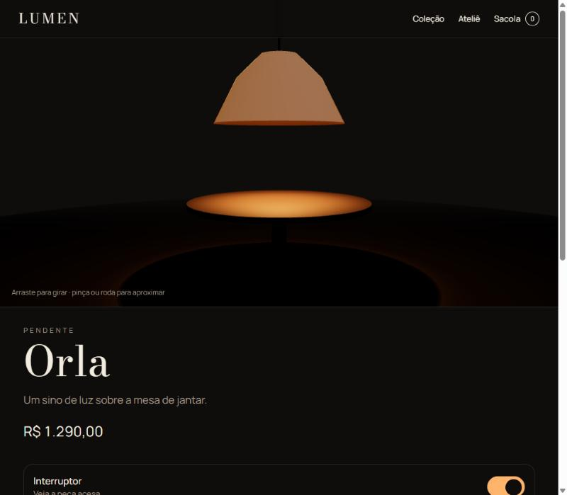

# Lumen · lumen-store

**PT** · Loja de uma marca fictícia de luminárias. Cada peça aparece em 3D, e dá para acendê-la e mudar a temperatura da luz (2200K a 5000K) antes de comprar. Carrinho, checkout Stripe em modo de teste e fallback de demonstração.
**EN** · Store for a fictional lighting brand. Every lamp is rendered in 3D and can be switched on and tuned from 2200K to 5000K before buying. Cart, Stripe Checkout in test mode, and a demo fallback.

🔗 **Ao vivo / Live:** https://lumen-store-vhcode.vercel.app



## Português

### Destaques
- **Visualização 3D** com React Three Fiber: as luminárias são modeladas em código (lathe, tube), sem arquivos pesados; luz pontual + spot com sombra, intensidade com transição suave
- **Interruptor e temperatura de cor**: o slider converte Kelvin em RGB e muda a luz da cena e o brilho da página ao mesmo tempo
- **Carrinho** em gaveta com frete grátis progressivo, persistido no navegador
- **Checkout**: rota `/api/checkout` recalcula preços no servidor a partir do catálogo (o cliente só manda slug, acabamento e quantidade) e abre o Stripe Checkout. Sem chave configurada, cai num checkout de demonstração que aceita só o cartão de teste `4242 4242 4242 4242`
- Páginas de produto estáticas (`generateStaticParams`), JSON-LD de Product, 3D carregado sob demanda (`next/dynamic`, `ssr: false`)

### Ativar o Stripe (opcional)
Crie uma chave **de teste** no painel do Stripe e adicione na Vercel:
```
STRIPE_SECRET_KEY=sk_test_...
```
A rota recusa chaves que não sejam de teste.

### Stack
Next.js 16 · React 19 · TypeScript · Tailwind CSS 4 · three.js / React Three Fiber / drei · Motion · Stripe · Vitest

### Como rodar
```bash
npm install
npm run dev
npm test
npm run build
```

## English

### Highlights
- 3D lamps built procedurally with React Three Fiber, real light switch and color-temperature slider that drives both the scene light and the page glow
- Cart drawer with free-shipping progress
- Server-side repricing in `/api/checkout` (never trusts client prices), Stripe Checkout in test mode, demo fallback when no key is set
- Static product pages, Product JSON-LD, lazy-loaded 3D

Set `STRIPE_SECRET_KEY=sk_test_...` on Vercel to enable real Stripe test checkout.
